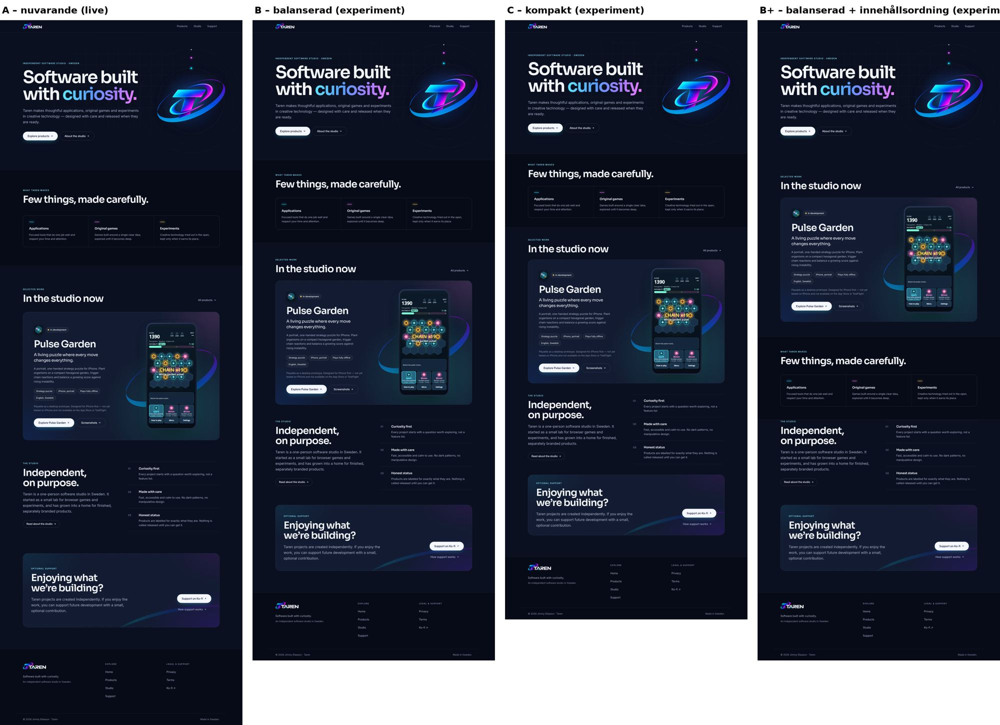
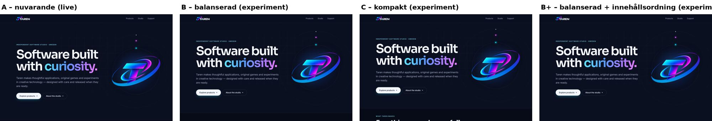
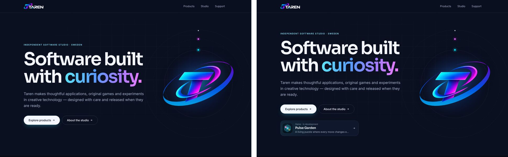
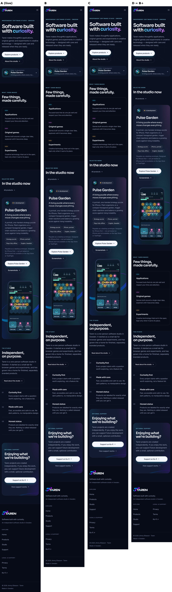
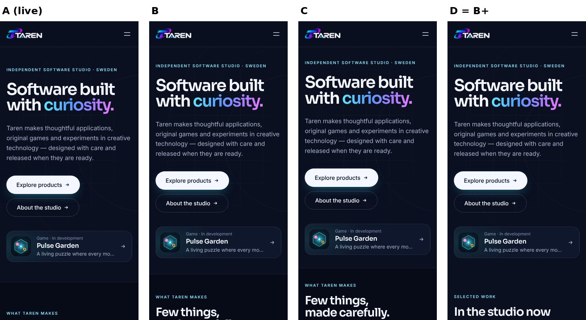
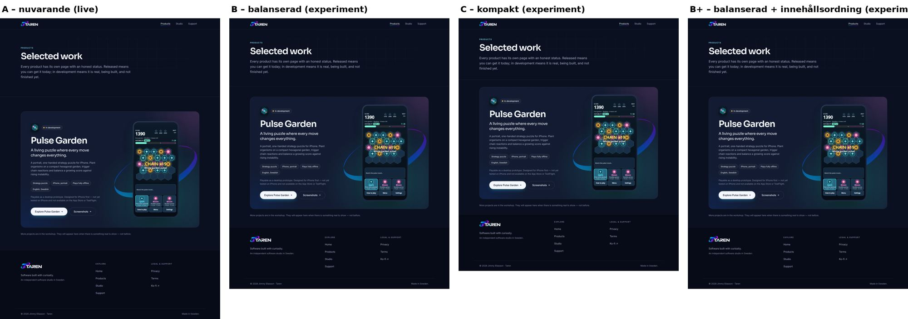
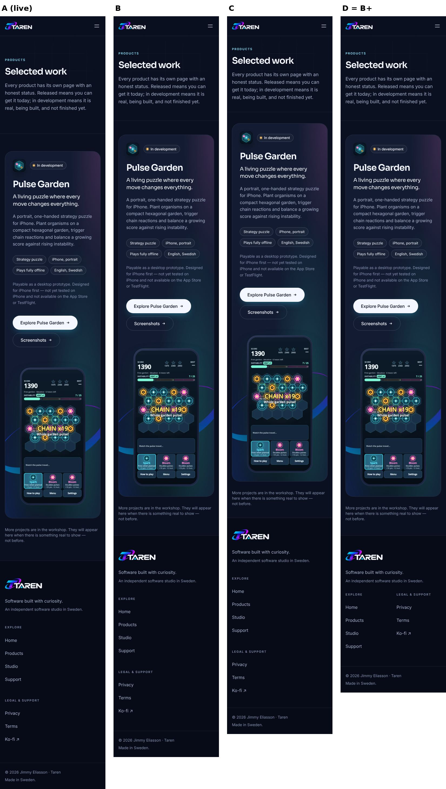

# Taren 2.3 — UX-audit: vertikalt avstånd, scrolldjup och innehållstäthet

Datum: 2026-11-18 · Mätt mot **live https://taren.se** (`main` @ `ce24ec5`) · Analysgren `analysis/taren-spacing-ux-audit`.
**Detta är en audit.** Ingenting på `main` eller på sajten har ändrats. Variant B, C och B+ nedan är **experiment**:
riktiga sidor med riktiga bilder, där en extra stilmall har lagts på i en isolerad webbläsare. De är inte
produktionsdesign.

---

## 1. Sammanfattning

- Ägarens upplevelse stämmer **delvis**. På **desktop** är hero och sektionsavstånd generösa:
  - heron tar 91 % av skärmen vid 1440×900, men innehållet fyller bara 57 % av den;
  - det är 241–325 px tomrum mellan sektionerna;
  - den utvalda produkten (Pulse Garden) syns först efter **1,8 skärmhöjder**.
- På **mobil** är avstånden redan måttliga (80 px). Pulse Garden syns redan i första skärmen via ett litet kort i heron.
  Det långa scrollandet på mobil beror på **innehållets mängd och form**, inte på luft:
  - "In the studio now" är 2 skärmhöjder;
  - sidfoten är 1 skärmhöjd;
  - produktsidan för Pulse Garden är 11–12 skärmhöjder.
- **Att bara minska avstånden ger lite:** −3 % sidhöjd på mobil och −8 % på desktop (B), som mest −17 % (C).
- **Störst effekt per ändring har innehållet i första skärmen.** Att visa det befintliga Pulse Garden-kortet i heron
  även på desktop för den utvalda produkten från 1,8 skärmar till **första skärmen**, utan att designen tappar luft.
- **Rekommendation: B+** = balanserade avstånd (B), produktkortet i heron på desktop, och sidfoten i två kolumner på
  mobil. Den förväntade minskningen av scrollning är beskriven i §6.

---

## 2. Metod

Mätskriptet finns i `site/scripts/measure-spacing.mjs` och kan köras om:
`node scripts/measure-spacing.mjs https://taren.se A|B|C|D <mapp>`

- **Uppsättning:** Playwright med Chromium och `prefers-reduced-motion: reduce` (så att animationer inte påverkar
  mätningen). Typsnitten var laddade, och sidan scrollades en gång så att lazy-laddade bilder renderades.
- **Sidor:** start, produkter, Pulse Garden, studio, support, privacy och terms.
- **Skärmstorlekar:** 375×812, 390×844, 768×1024, 1024×768, 1440×900, 1920×1080 och 2560×1440.

| Mått | Hur |
|---|---|
| Sidhöjd | `scrollHeight` i px och i antal skärmhöjder |
| Skärmar till sidfoten | sidfotens överkant ÷ skärmhöjden |
| Herohöjd | första sektionen i `<main>`, i px och i % av skärmhöjden |
| Herons innehållsfyllnad | höjden av allt synligt innehåll i heron ÷ herons höjd |
| Första innehåll under heron | överkanten av första innehållet i nästa sektion, i skärmhöjder (< 1,0 betyder att det syns utan scroll) |
| Avstånd mellan sektioner | tomt avstånd från sista innehållet i en sektion till första innehållet i nästa |
| Oanvänd yta | andel pixelrader mellan sidhuvud och sidfot som saknar innehåll |
| Landmärken | var "In the studio now", första produktkortet, supportrutan och Ko-fi-knappen ligger, i skärmhöjder |

Med **innehåll** menas:
- textrader, räknade med full radhöjd så att vanligt radavstånd inte räknas som tomt;
- bilder;
- knappar och länkar;
- kort och paneler med kant eller bakgrund.

**Dekoration räknas inte som innehåll:** ringarna, swooshen, rutnätet och T-symbolen i heron.

"Oanvänd yta" är därför ett **strängt** mått. Det omfattar avsiktlig luft och ytor som bara bär dekoration, inte bara
slöseri. Måttet säger hur luftig sidan är, inte att 30 % är fel.

---

## 3. Mätresultat (nuvarande sajt, A)

### 3.1 Översikt (skärmhöjder fram till sidfoten · oanvänd yta)

| Sida | 375×812 | 390×844 | 768×1024 | 1024×768 | 1440×900 | 1920×1080 | 2560×1440 |
|---|---|---|---|---|---|---|---|
| Start | 5,93 · 20 % | 5,64 · 20 % | 4,31 · 29 % | 4,80 · 33 % | 4,15 · 34 % | 3,54 · 35 % | 2,65 · 35 % |
| Produkter | 2,48 · 18 % | 2,38 · 18 % | 1,95 · 24 % | 2,02 · 32 % | 1,69 · 32 % | 1,41 · 32 % | 1,06 · 32 % |
| Pulse Garden | **11,34** · 22 % | **10,81** · 22 % | 6,91 · 31 % | 7,77 · 30 % | 6,64 · 30 % | 5,54 · 30 % | 4,15 · 30 % |
| Studio | 2,92 · 29 % | 2,74 · 30 % | 1,76 · 45 % | 2,37 · 45 % | 2,05 · 44 % | 1,70 · 44 % | 1,28 · 44 % |
| Support | 2,86 · 32 % | 2,68 · 32 % | 1,78 · 48 % | 2,35 · 49 % | 2,05 · 47 % | 1,71 · 47 % | 1,28 · 47 % |
| Privacy | 3,87 · 29 % | 3,65 · 29 % | 2,24 · 45 % | 3,00 · 45 % | 2,57 · 44 % | 2,14 · 44 % | 1,61 · 44 % |
| Terms | 3,13 · 32 % | 2,90 · 33 % | 1,91 · 48 % | 2,56 · 48 % | 2,20 · 47 % | 1,83 · 47 % | 1,37 · 47 % |

På textsidorna är den höga andelen oanvänd yta på bred skärm **avsiktlig**: textspalten är begränsad till en
läsbar radlängd (cirka 70 tecken), så sidorna blir korta (1,3–2,6 skärmar). Det är inte ett problem.

### 3.2 Startsidans hero och avstånd

| Skärm | Hero (px / % av skärmen) | Innehållsfyllnad | Nästa innehåll börjar | Avstånd mellan sektioner (px) | "In the studio now" | Supportrutan |
|---|---|---|---|---|---|---|
| 375×812 | 661 / 81 % | 83 % | 1,00 | 136 · 160 · 110 · 80 | 2,06 | 5,29 |
| 390×844 | 663 / 79 % | 83 % | 0,97 | 136 · 160 · 110 · 80 | 1,99 | 5,06 |
| 768×1024 | 707 / 69 % | 73 % | 0,87 | 209 · 241 · 128 · 128 | 1,51 | 3,88 |
| 1024×768 | 704 / **92 %** | **59 %** | 1,16 | **256** · 241 · 128 · 128 | 1,99 | 4,24 |
| 1440×900 | 816 / **91 %** | **57 %** | 1,11 | **287** · 241 · 128 · 128 | 1,81 | 3,65 |
| 1920×1080 | 896 / 83 % | **53 %** | 1,00 | **325** · 241 · 128 · 128 | 1,58 | 3,12 |
| 2560×1440 | 896 / 62 % | 53 % | 0,75 | 325 · 241 · 128 · 128 | 1,19 | 2,34 |

**Källa till desktop-värdena:**
- `.hero-grid { min-height: min(86dvh, 56rem) }` från 1024 px (`src/pages/index.astro`).
- Sektionernas padding är `md:py-28` (112 px) och `md:py-32` (128 px). Mellan två sektioner blir det därmed
  224–256 px, plus herons egen nedre padding (96 px).
- `min-height: 100vh/100dvh` används bara på `body` (för att sidfoten ska hamna längst ner) och på felsidan. Det
  är rimligt. Den enda stora höjd som tvingas fram är herons 86dvh.

### 3.3 Var höjden finns (sektionernas höjd i skärmhöjder)

| Sida och skärm | Sektioner |
|---|---|
| Start 390×844 | hero 0,79 · What Taren makes 0,98 · **In the studio now 2,01** · Studio 1,08 · Support 0,60 · **sidfot 1,00** |
| Start 1440×900 | **hero 0,91** · What 0,64 · In the studio now 1,29 · Studio 0,61 · Support 0,49 · sidfot 0,50 |
| Pulse Garden 390×844 | hero 1,74 · fakta 0,50 · om 0,98 · **så funkar det 2,26** · **funktioner 1,89** · skärmbilder 1,28 · status 1,38 · support 0,60 · sidfot 1,00 |
| Pulse Garden 1440×900 | hero 1,00 · fakta 0,28 · om 0,64 · så funkar det 0,96 · funktioner 0,78 · skärmbilder 1,28 · status 1,00 · support 0,49 · sidfot 0,50 |

---

## 4. Fynd

1. **Desktop-heron är för hög i förhållande till sitt innehåll.** Den tar 91–92 % av skärmen vid 1024–1440 px, men
   innehållet fyller bara 53–59 %. Den första skärmen visar därför bara rubrik, ingress och två knappar, ingen produkt.
   Här är den upplevda "tomheten" störst. Heron är snygg; problemet är att den är ensam i första skärmen.
2. **Sektionsavstånden på desktop är stora** (241–325 px mellan innehåll). Det ger en premiumkänsla, men vid
   1024×768 och 1440×900 blir rytmen gles. På 2560×1440 är samma avstånd proportionerligt rimliga.
3. **På mobil är luften redan måttlig** (80 px padding, 80–160 px mellan innehåll). Att krympa dem ytterligare ger bara
   −3 till −7 % sidhöjd och riskerar att sajten känns trång.
4. **Mobilens scrolldjup kommer av innehållets form:**
   - "In the studio now" (telefonbilden plus text) är 2 skärmar;
   - de tre kategorikorten staplas till 1 skärm;
   - sidfoten staplar två länklistor till en hel skärm (843 px).
5. **Produktsidan för Pulse Garden är lång på mobil** (11 skärmar). Det beror på steg med stora telefonbilder och sex
   funktionskort i en kolumn, inte på luft. Den sidan bör hanteras som en egen innehållsfråga.
6. **Produktkatalogen och textsidorna är redan korta** (1,1–2,5 skärmar till sidfoten på desktop). De behöver inga
   större ändringar.

---

## 5. UX-utvärdering: en ny besökare de första sekunderna

| Fråga | Mobil (390×844) | Desktop (1440×900) |
|---|---|---|
| Vad är Taren? | ✅ Rubrik och ingress i första skärmen | ✅ Samma |
| Vad gör Taren? | ✅ Ingressen nämner appar, spel och experiment; korten kommer vid 0,97 skärmar | ⚠️ Bara ingressen; korten kommer vid 1,1 skärmar |
| Vilken produkt är utvald? | ✅ Pulse Garden-kortet i heron, vid cirka 0,8 skärmar | ❌ Syns först vid **1,8 skärmar** (kortet är dolt på desktop) |
| Var lär man sig mer? | ✅ "Explore products", "About the studio" och menyn | ✅ Samma, plus navigering i sidhuvudet |
| Hur stöttar man eller kontaktar? | ⚠️ Supportrutan vid 5,1 skärmar; "Support" finns i menyn | ⚠️ Supportrutan vid 3,7 skärmar; "Support" finns i sidhuvudet |

Det som faktiskt göms för långt ner är **den utvalda produkten på desktop**. Support är frivilligt och ska inte
pressas uppåt, och "Support" finns redan i navigeringen.

---

## 6. Tre alternativ (plus det rekommenderade B+)

Alla siffror är uppmätta på de riktiga sidorna med respektive experimentstilmall (§2).

| | **A — Nuvarande** (små justeringar) | **B — Balanserad premium** | **C — Kompakt** | **B+ — Rekommenderas** |
|---|---|---|---|---|
| Herohöjd, desktop | min(86dvh, 56rem): 91 % vid 1440×900 | min(70dvh, 46rem): 84 % | efter innehållet: 80 % | som B, **plus produktkortet i heron** |
| Sektionspadding, desktop | 112–128 px | 78–90 px (−30 %) | 56–64 px (−50 %) | som B |
| Sektionspadding, mobil | 80 px | 56 px | 40 px | som B |
| Avstånd mellan innehåll, 1440 | 128–287 px | 89–224 px | 64–183 px | som B |
| Innehållstäthet (oanvänd yta, start 1440) | 34 % | 30 % | 26 % | 30 % |
| Mobil | oförändrad | lätt tätare | märkbart tätare | B **plus sidfot i 2 kolumner** |
| Sidhöjd, snitt alla sidor och skärmar | 0 | **−6 %** | **−10 %** | **−8 %** |
| Sidhöjd, mobil (375/390) | 0 | −3 % | −5 % | **−9 %** ¹ |
| Sidhöjd, desktop (1024–2560) | 0 | −8 % | −13 % | −8 % ² |
| Utvald produkt, desktop | 1,81 skärmar (1440) | 1,61 | 1,48 | **inom första skärmen**: kortet vid 0,82 (1024), 0,77 (1440), 0,64 (1920), 0,48 (2560) |
| Startsidan till sidfoten, 1440 | 4,15 | 3,78 | 3,55 | 3,78 |
| Startsidan till sidfoten, 390 | 5,64 | 5,39 | 5,21 | 5,39 (sidhöjd −9 %) |
| Visuella avvägningar | Mest luftig och "filmisk". Första skärmen visar ingen produkt. | Behåller lugnet; avstånden fortfarande generösa | Tydligt tätare, närmare en vanlig produktsajt; mindre premiumkänsla, särskilt på mobil | Som B; första skärmen får ett konkret innehåll utan att heron blir trång |

¹ Uppmätt som experiment D (B + sidfot i två kolumner + omordning på startsidan). Nästan hela vinsten på mobil kommer
från sidfoten. ² Produktkortet i heron ryms i herons befintliga höjd från 1440 px och lägger till 34 px vid 1024×768.

Siffrorna för B+ ovan gäller utan att sektionerna byter ordning. Jag testade också att flytta "In the studio now" före
"What Taren makes" (experiment D): då hamnar hela produktpresentationen vid 0,9–1,1 skärmar på alla storlekar. Det är
ett valfritt tillägg. Det ändrar berättelsen (först produkten, sedan vad Taren gör) och är därför ett innehållsbeslut,
inte ett avståndsbeslut.

### Rekommendation: **B+**
- Det ger störst förbättring där den uppmätta bristen finns: den utvalda produkten på desktop flyttas från 1,8 skärmar
  till första skärmen.
- Det minskar tomrummet på desktop med cirka 30 % utan att röra typografi eller färger.
- Det tar bort en hel skärmhöjd av sidfot på mobil.
- C ger bara 2–4 procentenheter mer minskning än B, men kostar premiumkänslan. Mätningen visar att avstånden inte är
  huvudorsaken till scrollningen, så den avvägningen lönar sig inte.
- Mindre luft är inte alltid bättre: på mobil och på 2560 px är dagens luft rimlig.

### Uppföljning (separat beslut): produktsidan för Pulse Garden på mobil
Sidan är 11 skärmar. Förslag som inte testats som experiment:
- stegen med mindre telefonbilder (eller bild och text sida vid sida från 390 px);
- funktionskorten i två kolumner från 390 px;
- skärmbildsgalleriet direkt efter heron.

Väntad effekt: −25 till −35 %. Det kräver egen design och mätning.

---

## 7. Visuella jämförelser (experiment, inte produktion)

Bilderna är genuina skärmbilder av live taren.se. B, C och B+ har experimentstilmallen pålagd i en isolerad webbläsare.

| Vy | Fil |
|---|---|
| Startsida desktop 1440, hela sidan |  |
| Startsida desktop 1440, första skärmen |  |
| Startsida desktop 1440: nuvarande jämfört med B+ med produktkortet i heron |  |
| Startsida mobil 390, hela sidan |  |
| Startsida mobil 390, första skärmen |  |
| Produkter desktop 1440, hela sidan |  |
| Produkter mobil 390, hela sidan |  |

Rådata per sida och skärm finns i `assets/spacing-audit/spacing-{A,B,C,D}.json`.

---

## 8. Föreslagna ändringar för B+ (implementeras inte förrän du har godkänt)

1. **Heron** (`src/pages/index.astro`): `min-height: min(86dvh, 56rem)` blir `min(70dvh, 46rem)` från 1024 px, och den
   nedre paddingen minskas en nivå.
2. **Produktkortet i heron** (`lg:hidden` tas bort på den befintliga `ProductTeaser` i heron), så att den utvalda
   produkten syns även på desktop. Det är samma komponent som redan används på mobil.
3. **Sektionspadding:** `py-20 md:py-28/32` blir ungefär `py-14 md:py-20/24`, på startsidan, produktsidan och
   `TextPage`. Helst görs det via en gemensam token (`--section-y`) i stället för utspridda klasser.
4. **Sidfoten på mobil:** de två länklistorna i två kolumner under 768 px.
5. **Valfritt:** "In the studio now" före "What Taren makes" (innehållsbeslut).
6. Visuella referensbilder uppdateras medvetet. Alla tester (responsivitet, mål ≥ 24/44 px, axe, rörelse) körs om, och
   ändringen läggs först på förhandsversionen.

## 9. Risker
- **Varumärke och känsla:** en lägre hero ger något mindre "filmisk" öppning. B behåller 70dvh, så T-symbolen har
  fortfarande gott om plats.
- **Dubbel länk till Pulse Garden** på desktop (kortet i heron och presentationen längre ner). Det är acceptabelt, och
  korten har olika sammanhang. Varje länk har ett tydligt namn.
- **Visuella referensbilder** behöver uppdateras (förväntat, inte ett fel).
- **Kommande produkter:** när fler produkter publiceras växer "In the studio now". Den tokenbaserade spacingen gör det
  lätt att justera.
- **Experimentens mätfel:** stilmallen skalar Tailwind-klasser i grupp. En riktig implementation kan bli några procent
  annorlunda. Den mäts om med samma skript.

## 10. Tillgänglighet
- Typografi, kontrast, fokusmarkeringar och tryckytor ändras inte. Kraven om minst 44 px för knappar och minst 24 px
  för alla mål testas automatiskt.
- Mindre scrollning hjälper användare med motoriska svårigheter och skärmförstoring. En tydlig produkt i första
  skärmen hjälper även kognitiv tillgänglighet.
- WCAG 1.4.12 (textavstånd) påverkas inte: radhöjd och textavstånd i brödtext ändras inte.
- Med reducerad rörelse beter sig sidan som i dag; inga nya animationer.
- Sidfoten i två kolumner behåller DOM-ordningen och rubrikerna.

## 11. Prestanda
- Ändringarna gäller bara CSS och klasser: noll extra JavaScript och noll extra anrop för avstånden.
- Produktkortet i heron på desktop laddar en ikon till (cirka 3–6 kB, i AVIF/WebP), som redan laddas på mobil.
- LCP-elementet (rubriken) påverkas inte, och layoutskiften blir inte fler (allt är statiskt). Lighthouse förväntas
  ligga kvar på 100; det mäts om vid en implementation.
